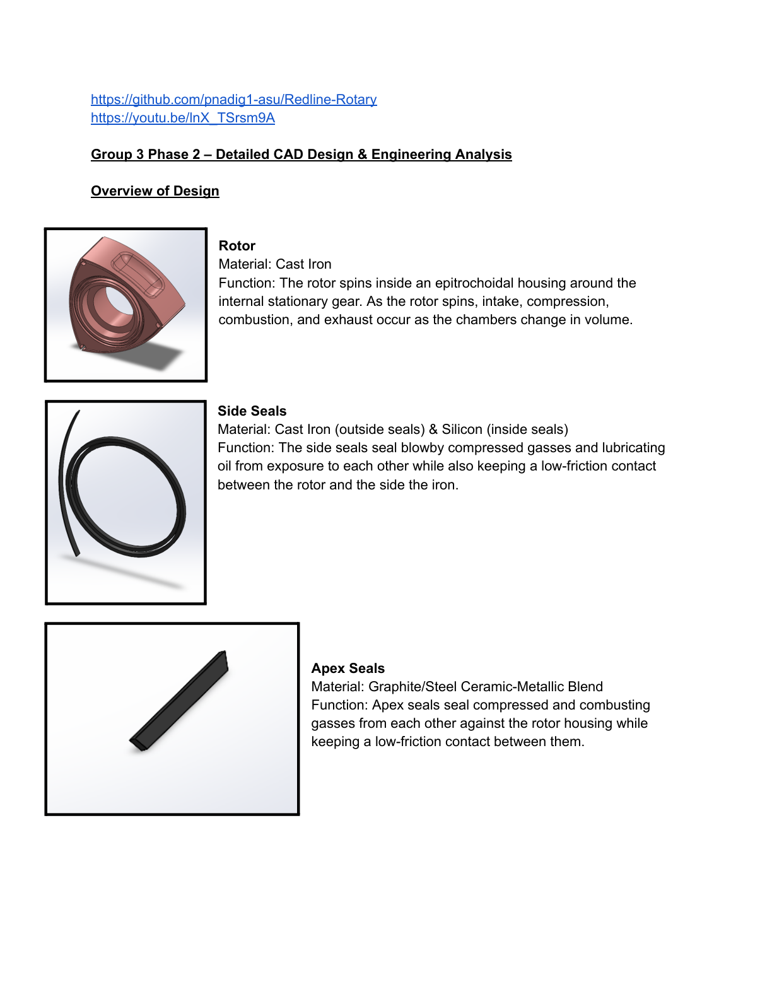
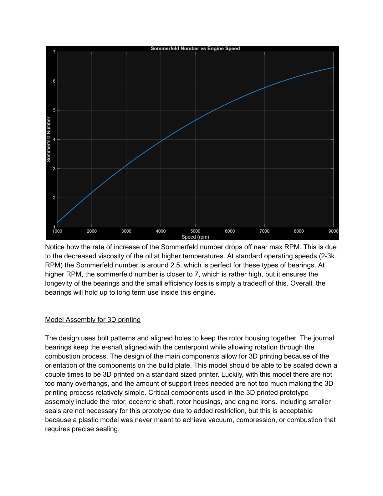
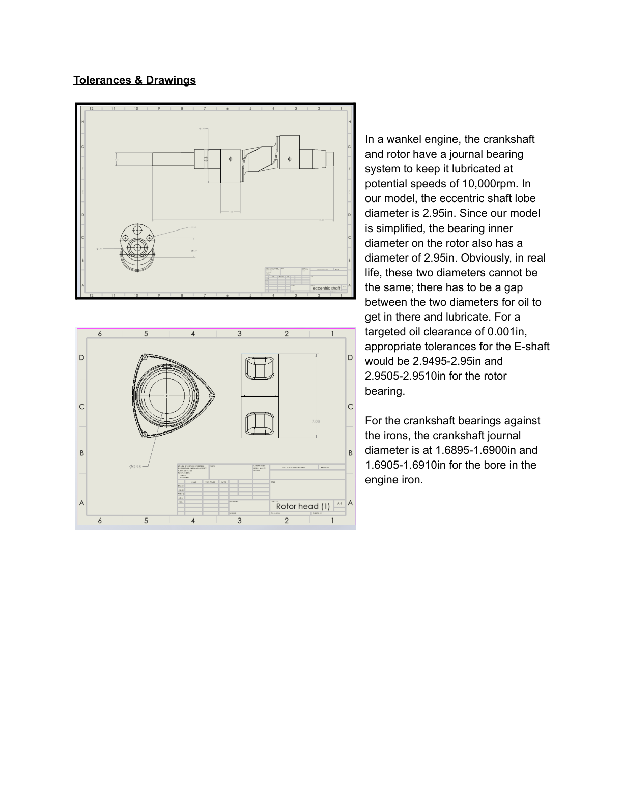
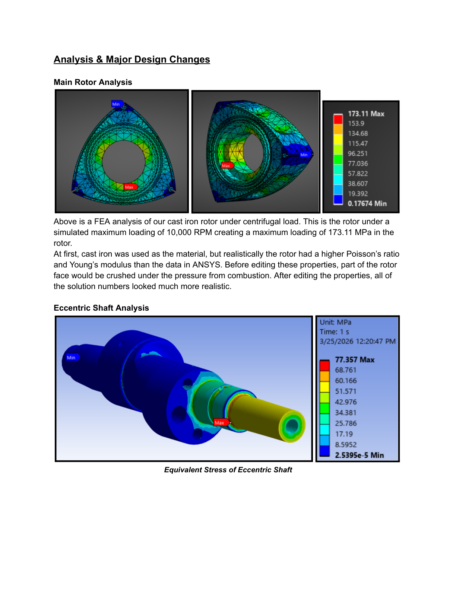
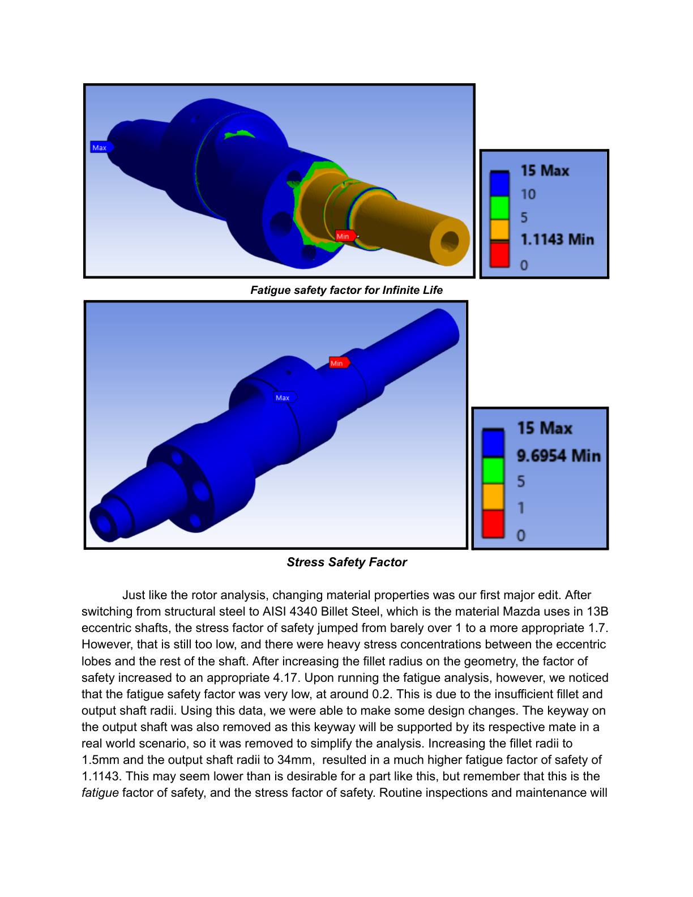
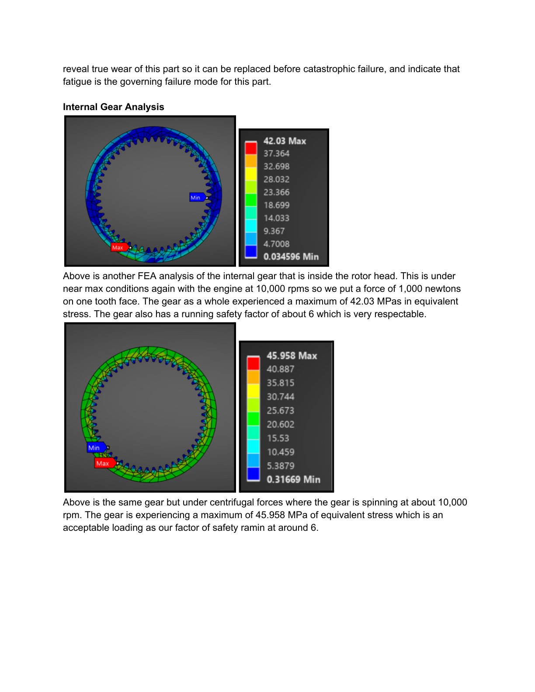

# Redline Rotary – Wankel Rotary Engine Design & Engineering Analysis

**Mechanical design, CAD modeling, and finite element analysis of a scaled Wankel rotary engine based on Mazda's 13B engine architecture.**

Redline Rotary was a team-based engineering project completed as part of **MEE 342 – Principles of Mechanical Design** at Arizona State University. The project focused on understanding, modeling, and evaluating the mechanical design of a Wankel rotary engine through detailed CAD development and engineering analysis.

## Project Overview

Unlike conventional reciprocating piston engines, the Wankel rotary engine uses a rotating triangular rotor within an epitrochoidal housing to convert combustion energy into mechanical torque.

The project involved studying the engine's operating principles, decomposing its mechanical subsystems, developing detailed SolidWorks models, and evaluating critical components under simulated operating conditions.

The design was based on a scaled version of Mazda's 13B rotary engine architecture, with particular attention to component geometry, gear relationships, material selection, tolerances, stress concentrations, fatigue, and bearing lubrication.

## Project Visuals

### Engine Design and Assembly

### CAD Drawings and Tolerances

### Finite Element Analysis (FEA)

## Project Objectives

- Understand the operating principles and kinematics of a Wankel rotary engine.
- Identify critical mechanical components and their functions.
- Develop detailed 3D CAD models and an integrated engine assembly.
- Evaluate material and geometric design choices.
- Perform static stress and fatigue assessments using ANSYS.
- Identify potential failure modes and improve critical component designs.
- Consider manufacturability and 3D-printing constraints.

## Engine Architecture and Major Components

The design incorporated the following major components:

| Component | Function |
|---|---|
| Rotor | Rotates within the epitrochoidal housing to produce the engine's operating cycles. |
| Rotor housing | Encloses the rotor and provides the working chamber geometry. |
| Eccentric shaft | Transfers the rotor's motion into usable mechanical torque. |
| Stationary gear | Controls the rotor's motion through the gear relationship. |
| Internal spur gear | Integrates with the rotor and coordinates its movement. |
| Apex seals | Seal the combustion chambers along the rotor housing surface. |
| Side seals | Maintain sealing between the rotor and engine irons. |
| Apex seal springs | Support consistent contact between the apex seals and housing. |
| Engine irons | Form the side surfaces of the combustion chambers and incorporate supporting features. |
| Bearings | Support rotating components and enable controlled motion. |

## Phase 1 – System Understanding and Conceptual Design

The initial phase focused on understanding the Wankel rotary engine's operation and identifying its critical engineering considerations.

Key work included:

- Studying the intake, compression, combustion, and exhaust cycles.
- Understanding the rotor, eccentric shaft, and stationary gear kinematic relationship.
- Decomposing the engine into its primary mechanical subsystems.
- Reviewing material choices and critical component interfaces.
- Identifying failure modes involving apex seals, bearings, lubrication, overheating, and thermal distortion.
- Establishing important design parameters for detailed CAD development.

Particular attention was given to apex seal durability, bearing lubrication, and thermal management because of their influence on engine reliability.

## Phase 2 – Detailed CAD Design and Engineering Analysis

The second phase focused on developing the detailed mechanical design and evaluating critical components under simulated operating conditions.

### 1. SolidWorks CAD Modeling and Assembly

Developed detailed 3D component models and assemblies representing the major mechanical systems of the rotary engine.

The CAD work included:

- Rotor and internal spur gear modeling.
- Eccentric shaft design.
- Rotor housing and engine iron modeling.
- Apex and side seal components.
- Stationary gear and supporting components.
- Assembly integration and component alignment.
- Engineering drawings and dimensional tolerances.
- Exploded assembly visualization.

The assembly incorporated the mechanical interfaces and gear relationships required to represent the rotary engine's motion.

### 2. ANSYS Finite Element Analysis

Finite element analysis was performed on critical components to evaluate structural behavior under simulated operating conditions.

**Rotor analysis**

- Evaluated the cast iron rotor under centrifugal loading at a simulated 10,000 RPM.
- Reported maximum equivalent stress of 173.11 MPa.
- Reviewed material property assumptions and their influence on simulation results.

**Eccentric shaft analysis**

- Evaluated equivalent stress and fatigue behavior.
- Investigated stress concentrations around the eccentric lobes and shaft geometry.
- Examined the effect of material selection and geometric modifications on safety factors.

**Internal gear analysis**

- Evaluated gear stress under an applied tooth load of 1,000 N.
- Examined centrifugal loading at approximately 10,000 RPM.
- Conducted fatigue assessment of the gear under repeated loading.

### 3. Mechanical Design Calculations and Design Improvements

Engineering calculations and simulation results informed several design modifications.

| Component | Design consideration | Reported outcome |
|---|---|---|
| Eccentric shaft | Material selection and increased fillet radii | Stress factor of safety improved to 4.17 |
| Eccentric shaft | Fatigue assessment and geometric modifications | Fatigue factor of safety improved to 1.1143 |
| Internal gear | Tooth loading and centrifugal loading | Static safety factor approximately 6 |
| Internal gear | Repeated tooth loading | Fatigue safety factor of 2.0509 |

The eccentric shaft analysis highlighted the importance of geometric transitions and stress concentrations in rotating components. Increasing the fillet radii and refining the shaft geometry improved its calculated structural performance.

The analysis also identified fatigue as a governing design consideration for the eccentric shaft.

### 4. Tolerances and Bearing Considerations

The project examined journal bearing interfaces and the dimensional relationships required for lubrication and reliable rotation.

Design considerations included:

- Shaft and bearing diameters.
- Oil clearance.
- Dimensional tolerances.
- Bearing alignment.
- Lubrication film behavior.
- The effect of operating speed and temperature on bearing lubrication.

The analysis also considered the Sommerfeld number as a means of evaluating lubricant film behavior across different engine speeds.

### 5. Design for Manufacturing and Prototyping

The CAD assembly was developed with reduced-scale 3D printing in mind.

Design considerations included:

- Component orientation and printer build-volume constraints.
- Assembly alignment and bolt patterns.
- Gear engagement and rotational clearances.
- Support requirements and overhangs.
- Dimensional limitations of printed components.

The project distinguished between demonstrating the engine's mechanical motion and reproducing actual combustion, compression, and operating temperatures. A 3D-printed model was intended to demonstrate the mechanical principles rather than function as a combustion engine.

## Individual Contribution

Pranav contributed across the engineering development of Redline Rotary, with primary involvement in:

- **CAD modeling:** Developing mechanical component models and supporting the integrated SolidWorks assembly.
- **Finite element analysis:** Performing and interpreting ANSYS simulations to evaluate component stresses and structural behavior.
- **Mechanical design calculations:** Working on design parameters, material selection, tolerances, stress evaluation, and factor-of-safety assessments.
- **Design optimization:** Using engineering analysis to identify critical areas and inform geometric improvements.
- **Engineering documentation:** Contributing to the technical reports, design explanations, and analysis documentation.

The project was completed collaboratively, with the final design and analysis representing the team's collective engineering work.

## Tools and Technologies

- SolidWorks – 3D CAD modeling, assemblies, and engineering drawings.
- ANSYS – Finite element analysis and structural evaluation.
- Mechanical design calculations – Stress, fatigue, tolerances, and bearing considerations.
- 3D printing – Prototype design and manufacturability planning.

## Project Details

| | |
|---|---|
| Project | Redline Rotary – Wankel Rotary Engine |
| Course | MEE 342 – Principles of Mechanical Design |
| Institution | Arizona State University |
| Project type | Team-based mechanical engineering project |
| Design reference | Mazda 13B Wankel rotary engine |
| Primary engineering focus | CAD, FEA, mechanical design, and fatigue analysis |

## Key Engineering Takeaways

Redline Rotary provided hands-on experience in applying mechanical engineering principles to a complex rotating assembly.

The project connected CAD development with structural analysis and engineering calculations, demonstrating how material properties, component geometry, tolerances, and loading conditions influence mechanical performance.

A major learning outcome was understanding how simulation results can guide design decisions, particularly when addressing stress concentrations, fatigue behavior, and reliability in high-speed rotating machinery.

---

*Academic engineering project completed as part of MEE 342 at Arizona State University. Phase 1 and Phase 2 design and analysis documentation are represented in this repository.*
